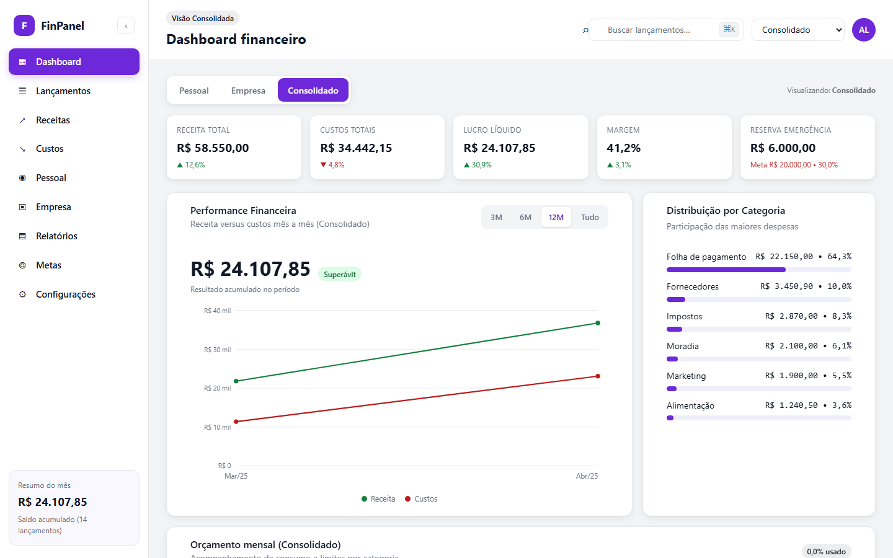

# Painel Financeiro

**Protótipo de alta fidelidade de um dashboard financeiro** que consolida finanças pessoais e de uma
empresa numa única base, com três escopos: **Pessoal**, **Empresa** e **Consolidado**.

Arquivo único de HTML, CSS e JavaScript — sem framework, sem build, sem dependência externa.

**▶ [Ver o protótipo ao vivo](https://augusto10vellozo-coder.github.io/painel-financeiro/)**



---

## O que o protótipo demonstra

- **Três escopos na mesma tela** — a troca entre Pessoal / Empresa / Consolidado recalcula todos os
  indicadores, inclusive o gráfico e a distribuição por categoria.
- **KPIs** de receita total, custos, lucro líquido, margem e reserva de emergência, com variação
  percentual contra o período anterior.
- **Gráfico de performance** receita × custos, em SVG, com filtro de 3, 6, 12 meses e "tudo".
- **Distribuição por categoria** com barras proporcionais e participação percentual.
- **Orçamento mensal** com acompanhamento de consumo por categoria.
- Navegação lateral completa: Dashboard, Lançamentos, Receitas, Custos, Pessoal, Empresa,
  Relatórios, Metas e Configurações.
- Busca de lançamentos e dados persistidos em `localStorage` — funciona offline.

## Decisões técnicas

**Arquivo único, sem dependência.** O protótipo abre com duplo clique, em qualquer máquina, sem
instalar nada. Para validar layout e regra de negócio com quem toma decisão, isso vale mais do que
um projeto com `npm install`.

**Gráfico em SVG, não em biblioteca.** Duas séries e uma área de eixo não justificam 90 KB de
dependência. O SVG é gerado a partir dos dados em memória, o que também deixou o comportamento
previsível ao trocar de escopo.

**Dados de exemplo isolados.** O protótipo usa dados fictícios em memória e `localStorage`. Ele
**não** é a fonte de verdade do produto — existe para validar interface e regras de cálculo antes de
escrever o app definitivo.

## O que está aqui além do código

| Documento | Conteúdo |
|---|---|
| [`CONTEXTO.md`](CONTEXTO.md) | Visão completa: decisões, telas, dados, regras e bugs conhecidos |
| [`TAREFAS.md`](TAREFAS.md) | Backlog priorizado |
| [`docs/especificacao-fase1-backend.md`](docs/especificacao-fase1-backend.md) | Schema, RLS, regras, endpoints e critérios de aceite |
| [`docs/especificacao-fase2-frontend.md`](docs/especificacao-fase2-frontend.md) | Design system, layout, componentes e telas |

## Status

Protótipo visual aprovado (versão 6). A implementação definitiva em React + TypeScript + Vite +
Tailwind + Supabase está em andamento e **não está neste repositório** — este repo guarda o
protótipo e as especificações que orientam a implementação.

## Como abrir

Duplo clique em [`prototipo/painel-financeiro-v6.html`](prototipo/painel-financeiro-v6.html).

Ou, para servir via HTTP:

```bash
npx serve .
```
